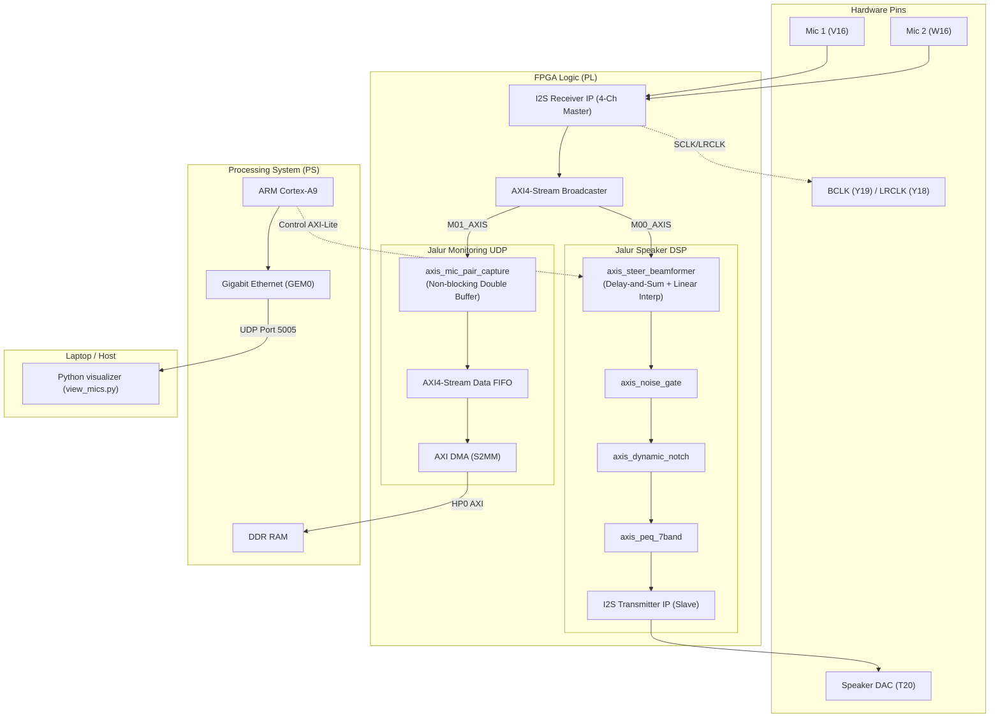

# Panduan Lengkap Pembuatan Project 2-Mic Steerable Beamformer
**Target Board:** Antminer S9 Control Board (Xilinx Zynq-7000 / XC7Z010-1CLG240)  
**Tools:** Vivado 2019.1 & Xilinx SDK 2019.1  
**Jumlah Mikrofon:** 2x I2S Microphone (INMP441 / ICS-43434)  

---

## Daftar Isi
1. [Konsep Dasar Delay-and-Sum Beamforming](#1-konsep-dasar-delay-and-sum-beamforming)
2. [Kebutuhan Hardware & Wiring Pinout](#2-kebutuhan-hardware--wiring-pinout)
3. [Arsitektur Sistem & Aliran Data](#3-arsitektur-sistem--aliran-data)
4. [Langkah Pembuatan di Xilinx Vivado (Hardware / PL)](#4-langkah-pembuatan-di-xilinx-vivado-hardware--pl)
5. [Konfigurasi Block Design (IP Cores & Routing)](#5-konfigurasi-block-design-ip-cores--routing)
6. [Constraint Pinout (XDC) & Sintesis Bitstream](#6-constraint-pinout-xdc--sintesis-bitstream)
7. [Langkah Pembuatan di Xilinx SDK (Firmware / PS)](#7-langkah-pembuatan-di-xilinx-sdk-firmware--ps)
8. [Pengujian & Visualisasi Realtime di Laptop (Python)](#8-pengujian--visualisasi-realtime-di-laptop-python)
9. [Panduan Pengaturan Sudut & DSP Audio (Runtime)](#9-panduan-pengaturan-sudut--dsp-audio-runtime)
10. [Troubleshooting & Tips Praktis](#10-troubleshooting--tips-praktis)

---

## 1. Konsep Dasar Delay-and-Sum Beamforming

### 1.1 Prinsip Kerja
Beamforming 2 mikrofon bekerja dengan prinsip **Delay-and-Sum**:
1. Gelombang suara yang datang dari sudut tertentu ($\theta$) akan tiba di salah satu mikrofon lebih dahulu daripada mikrofon lainnya karena adanya perbedaan jarak tempuh ($\Delta x$).
2. Selisih waktu kedatangan gelombang (TDoA / *Time Difference of Arrival*):
   $$\tau = \frac{d \cdot \sin(\theta)}{c}$$
   - $d$ = Jarak fisik antarmikrofon (default: $0.05\text{ m} = 5\text{ cm}$)
   - $c$ = Kecepatan suara di udara ($\approx 343\text{ m/s}$)
   - $\theta$ = Sudut datang suara ($-90^\circ$ sampai $+90^\circ$, diukur dari garis tegak lurus sumbu mic)
3. Selisih waktu ini dikonversi ke dalam jumlah sampel digital audio ($Fs = 48\text{ kHz}$):
   $$\Delta n = \tau \cdot Fs = \frac{d \cdot \sin(\theta) \cdot Fs}{c}$$
   - Untuk jarak $5\text{ cm}$ dan $Fs = 48\text{ kHz}$, delay maksimum pada $\pm 90^\circ$ adalah:
     $$\Delta n_{\max} = \frac{0.05 \cdot 1 \cdot 48000}{343} \approx 6.997 \approx 7\text{ sampel}$$
4. **Penjajaran & Penjumlahan:** Sinyal dari mic yang menerima lebih awal ditunda (delay) sebesar $\Delta n$. Setelah kedua sinyal sejajar fasanya (*in-phase*), keduanya dijumlahkan lalu dibagi dua:
   $$y[n] = \frac{x_1[n - \text{delay}_1] + x_2[n - \text{delay}_2]}{2}$$
   - Suara dari arah target akan mengalami penguatan konstruktif (+6 dB sebelum dinormalisasi).
   - Suara dari arah lain yang fasanya acak/berbeda akan mengalami pelemahan destruktif (*attenuation*).

### 1.2 Fractional Delay (Q8 Fixed-Point)
Karena $\Delta n$ jarang berupa bilangan bulat persis, FPGA menggunakan representasi fixed-point Q8 (1 sampel = 256 unit). Modul Verilog melakukan **linear interpolation** antara dua sampel berdekatan untuk menjaga respon fase frekuensi tinggi tetap mulus.

---

## 2. Kebutuhan Hardware & Wiring Pinout

### 2.1 Komponen
1. **Control Board Antminer S9** (Zynq XC7Z010CLG240).
2. **2x Modul Mikrofon I2S** (misal: INMP441 / ICS-43434 / SPH0645).
3. **1x Modul I2S DAC / Speaker Amp** (misal: MAX98357A) untuk mendengar hasil.
4. **Kabel LAN RJ45** untuk koneksi UDP ke Laptop/PC.
5. **Kabel JTAG/UART** untuk pemrograman dan serial monitor (Baudrate 115200).

### 2.2 Tabel Sambungan Pin (XDC)

| Sinyal FPGA | Pin FPGA S9 | Arah | Keterangan / Sambungan Modul |
|---|---|---|---|
| `lrclk_out_0` | **Y18** | Output (LVCMOS33) | Word Select (WS / LRCLK) ke Mic 1, Mic 2, & DAC |
| `sclk_out_0` | **Y19** | Output (LVCMOS33) | Continuous Bit Clock (SCK / BCLK) ke Mic 1, Mic 2, & DAC |
| `sdata_0_in_0` | **V16** | Input (LVCMOS33) | Serial Data Out (SD) dari **Mic 1** |
| `sdata_1_in_0` | **W16** | Input (LVCMOS33) | Serial Data Out (SD) dari **Mic 2** |
| `sdata_0_out_0` | **T20** | Output (LVCMOS33) | Serial Data In (DIN) ke **DAC / Speaker MAX98357A** |
| `led_clock` | **M19** | Output (LVCMOS33) | LED Indikator Heartbeat / Audio Clock |

> [!IMPORTANT]
> - Pin **L/R (Left/Right)** pada kedua modul mikrofon:
>   - **Mic 1:** Pin L/R disambungkan ke **GND** (Kanal Left, TID = 0).
>   - **Mic 2:** Pin L/R disambungkan ke **GND** (Kanal Left pada data baris 2, TID = 2).
> - Jarak fisik kedua lubang mikrofon diatur tepat **5.0 cm**.
> - VDD mikrofon dan DAC wajib disambungkan ke **3.3V** dan GND bersama (*common ground*).

---

## 3. Arsitektur Sistem & Aliran Data

Sistem memiliki **dua jalur independen** yang bekerja secara paralel tanpa saling membebani:
1. **Jalur Speaker DSP (Realtime PL):** Memproses sinyal 2 mic secara hardware dengan latensi sangat rendah (< 1 ms), masuk ke beamformer, noise gate, notch filter, PEQ, lalu ke speaker.
2. **Jalur UDP Monitoring (LAN/PC):** Mengambil data mentah (raw PCM 24-bit) dari Mic 1 dan Mic 2 menggunakan double-buffer non-blocking capture, dikirim melalui AXI DMA ke DDR RAM, lalu distream lewat Ethernet UDP ke laptop untuk visualisasi.



---

## 4. Langkah Pembuatan di Xilinx Vivado (Hardware / PL)

### 4.1 Buka / Siapkan Project
1. Buka Xilinx Vivado 2019.1.
2. Buka project `i2s_beamformer.xpr` yang terletak di `/home/maruf/fpga/antminer_s9/i2s_beamformer/`.
3. Pastikan part target adalah **xc7z010clg240-1**.

### 4.2 Tambahkan File Source Verilog Baru
Pastikan modul-modul berikut ada di Project Sources (`Add Sources -> Add or create design sources`):
- `axis_steer_beamformer.v` (Modul delay-and-sum beamformer yang dapat diatur via register AXI-Lite)
- `axis_mic_pair_capture.v` (Modul capture non-blocking 128 frame per paket ke DMA)
- Modul pendukung DSP: `axis_noise_gate.v`, `axis_dynamic_notch.v`, `axis_peq_7band.v`

---

## 5. Konfigurasi Block Design (IP Cores & Routing)

Buka Block Design (`design_1.bd`) dan lakukan pengecekan / konfigurasi berikut:

### 5.1 ZYNQ7 Processing System
1. **Clock Configuration:**
   - `FCLK_CLK0`: **50 MHz** (digunakan untuk bus AXI Interconnect, DMA, AXI-Lite DSP, dan capture).
   - `Ethernet 0 Clock`: **125 MHz**.
2. **MIO Configuration:**
   - **Ethernet 0:** Enable, pilih `MIO 16 .. 27` (RGMII).
   - **MDIO:** Enable, pilih `MIO 52 .. 53`.
   - **UART 1:** Enable (untuk serial output terminal).
3. **PS-PL Interfaces:**
   - General Purpose AXI Master: Enable `M_AXI_GP0` (untuk konfigurasi register IP).
   - High Performance AXI Slave: Enable `S_AXI_HP0` (untuk DMA write ke DDR).

### 5.2 Clocking Wizard (`clk_wiz_0`)
- **Input Clock:** 50 MHz dari PS `FCLK_CLK0`.
- **Output Clock (`clk_out1`):** **12.288 MHz** (dihubungkan ke port `aud_mclk` pada I2S Receiver dan I2S Transmitter).
  *(Catatan: $12.288\text{ MHz} = 256 \times 48\text{ kHz}$ sampling rate)*.

### 5.3 I2S Receiver IP (`i2s_receiver_0`)
- **Mode:** Master (menghasilkan SCLK dan LRCLK).
- **Number of Audio Channels:** **4** (2 pasang stereo untuk menangani 2 mic).
- **Audio Clock:** Dihubungkan ke 12.288 MHz (`aud_mclk`).
- **Data Inputs:**
  - `sdata_0_in` $\rightarrow$ pin `sdata_0_in_0` (Mic 1).
  - `sdata_1_in` $\rightarrow$ pin `sdata_1_in_0` (Mic 2).
- **Output Port:**
  - `lrclk_out` $\rightarrow$ pin `lrclk_out_0` (Y18).
  - `sclk_out` $\rightarrow$ pin `sclk_out_0` (Y19).
  - `M_AXIS_AUD` $\rightarrow$ disambungkan ke input AXI4-Stream Broadcaster.

### 5.4 AXI4-Stream Broadcaster (`axis_broadcaster_0`)
- **Fungsi:** Menggandakan stream data 4-kanal dari I2S Receiver ke 2 cabang:
  - `M00_AXIS` $\rightarrow$ Menuju input `s_axis` pada `axis_steer_beamformer_0`.
  - `M01_AXIS` $\rightarrow$ Menuju input `s_axis` pada `axis_mic_pair_capture_0`.

### 5.5 Modul Beamformer (`axis_steer_beamformer`)
- Masukkan modul ke Block Design (`Add Module to Block Design`).
- **Parameter RTL:**
  - `MAX_DELAY = 16`
  - `DEFAULT_DELAY_Q8 = 1792` (nilai default +7 sampel)
  - `MIC1_TID = 0` (Kanal Left Mic 1)
  - `MIC2_TID = 2` (Kanal Left Mic 2)
- **Koneksi Port:**
  - `s_axis` $\leftarrow$ dari `M00_AXIS` Broadcaster.
  - `m_axis` $\rightarrow$ menuju `s_axis` `axis_noise_gate` (lalu berantai ke notch, PEQ, dan TX).
  - `s_axi` $\leftarrow$ sambungkan ke AXI Interconnect GP0 (diberi base address di Address Editor).
  - `aclk` & `s_axi_aclk` $\leftarrow$ 50 MHz (`FCLK_CLK0`).
  - `aresetn` & `s_axi_aresetn` $\leftarrow$ `peripheral_aresetn` dari Reset Controller.

### 5.6 Modul Capture & DMA Monitoring
1. `axis_mic_pair_capture_0`:
   - `s_axis` $\leftarrow$ dari `M01_AXIS` Broadcaster.
   - `m_axis` $\rightarrow$ menuju input `s_axis` dari `axis_data_fifo_0`.
2. `axis_data_fifo_0`:
   - Data Width: 32 bit, TLAST enabled, FIFO Depth 4096.
   - Output `m_axis` $\rightarrow$ menuju `S_AXIS_S2MM` pada `axi_dma_0`.
3. `axi_dma_0`:
   - Mode: Simple DMA (Scatter Gather dimatikan).
   - Write Channel (S2MM) aktif, Read Channel (MM2S) dimatikan.
   - Master `M_AXI_S2MM` $\rightarrow$ tersambung ke `S_AXI_HP0` pada Zynq PS.

### 5.7 I2S Transmitter IP (`i2s_transmitter_0`)
- **Mode:** Slave (mengikuti clock SCLK dan LRCLK dari I2S Receiver).
- Input AXI-Stream menerima data audio hasil olahan DSP (PEQ).
- Serial Data Output `sdata_0_out` $\rightarrow$ pin `sdata_0_out_0` (T20 ke DAC).

### 5.8 Address Editor
Buka tab **Address Editor**, klik kanan $\rightarrow$ **Assign All**.  
Pastikan base address terdaftar rapi (misal: `axis_steer_beamformer` di rentang `0x43C0_0000` / `0x43C1_0000`). Catat alamat ini!

---

## 6. Constraint Pinout (XDC) & Sintesis Bitstream

1. Pastikan file `constraints.xdc` memuat konfigurasi pin fisik berikut:
```tcl
set_property PACKAGE_PIN Y18 [get_ports lrclk_out_0]
set_property PACKAGE_PIN Y19 [get_ports sclk_out_0]
set_property PACKAGE_PIN V16 [get_ports sdata_0_in_0]
set_property PACKAGE_PIN W16 [get_ports sdata_1_in_0]
set_property PACKAGE_PIN T20 [get_ports sdata_0_out_0]
set_property PACKAGE_PIN M19 [get_ports led_clock]

set_property IOSTANDARD LVCMOS33 [get_ports lrclk_out_0]
set_property IOSTANDARD LVCMOS33 [get_ports sclk_out_0]
set_property IOSTANDARD LVCMOS33 [get_ports sdata_0_in_0]
set_property IOSTANDARD LVCMOS33 [get_ports sdata_1_in_0]
set_property IOSTANDARD LVCMOS33 [get_ports sdata_0_out_0]
set_property IOSTANDARD LVCMOS33 [get_ports led_clock]
```
2. Klik **Validate Design** (`F6`). Pastikan pesan validasi sukses (*Validation successful*).
3. Klik **Generate Bitstream** dan tunggu hingga proses implementasi selesai tanpa error timing.
4. Export Hardware:
   - Pilih menu **File $\rightarrow$ Export $\rightarrow$ Export Hardware**.
   - **Wajib centang:** `Include bitstream`.
   - Simpan file `.hdf` ke lokasi default SDK.

---

## 7. Langkah Pembuatan di Xilinx SDK (Firmware / PS)

### 7.1 Menyiapkan Proyek SDK
1. Buka Xilinx SDK 2019.1 dari Vivado: **File $\rightarrow$ Launch SDK**.
2. Platform hardware aktif akan otomatis mendeteksi file `.hdf` terbaru.
3. Aplikasi utama yang digunakan adalah **`mic_direction_udp`** di folder `i2s_beamformer.sdk/mic_direction_udp`.
4. Pastikan file-file berikut ada di dalam folder `src/`:
   - `main.c`: Inisialisasi platform, Ethernet, dan loop utama.
   - `capture_loop.c`: Loop pengambilan DMA dan pengiriman paket UDP.
   - `audio_path.c` & `audio_path.h`: Inisialisasi dan konfigurasi rantai DSP (Beamformer, Noise Gate, Notch, PEQ, TX).
   - `audio_config.h`: Parameter sudut target, jarak mic, dan gain.
   - `steer_beamformer.c` & `steer_beamformer.h`: Driver register AXI-Lite untuk beamformer.
   - `mic_udp.c` & `mic_udp.h`: Pembungkus header paket UDP 32-byte + 1024-byte payload.

### 7.2 Konfigurasi Parameter di `audio_config.h`
Pengaturan utama audio ada pada file [audio_config.h](file:///home/maruf/fpga/antminer_s9/i2s_beamformer/i2s_beamformer.sdk/mic_direction_udp/src/audio_config.h):
```c
#define AUDIO_TARGET_ANGLE_DEG   (+90.0f)   // Arah target: +90° (sisi Mic1), -90° (sisi Mic2), 0° (tengah)
#define AUDIO_MIC_SPACING_M      (0.05f)    // Jarak antarmikrofon (5 cm)
#define AUDIO_MIC_GAIN_DB        (0.0f)     // Gain input mic (dB)
#define AUDIO_MASTER_GAIN_DB     (0.0f)     // Gain output master (dB)
#define AUDIO_GATE_ENABLE        (0)        // 0 = bypass noise gate, 1 = aktif
#define AUDIO_NOTCH_ENABLE       (0)        // 0 = bypass notch filter, 1 = aktif
#define AUDIO_PEQ_BYPASS         (1)        // 1 = bypass parametric EQ, 0 = aktif

#define AUDIO_LAPTOP_IP          "172.155.0.9" // IP Laptop penerima UDP (sesuaikan dengan IP laptop)
#define AUDIO_UDP_PORT           5005          // Port UDP
```

### 7.3 Kompilasi & Build
1. Periksa `makefile.defs` pada folder project `mic_direction_udp` untuk memastikan flag `-lm` (math library untuk fungsi `sinf`) aktif:
   ```makefile
   LIBS := -Wl,--start-group,-lxil,-llwip4,-lmc,-lm,--end-group
   ```
2. Klik kanan project `mic_direction_udp` $\rightarrow$ **Build Project**.
3. Pastikan file binary `mic_direction_udp.elf` terbentuk tanpa error.

### 7.4 Patch Broadcom PHY S9 (Penting untuk Ethernet)
Board Antminer S9 menggunakan Ethernet PHY **Broadcom B50612**. Driver lwIP default Vivado 2019.1 belum mendukung autonegotiation register khusus PHY ini.
- Jika link Ethernet tidak menyala / status negosiasi salah, jalankan script patch:
  ```bash
  cd /home/maruf/fpga/antminer_s9/i2s_beamformer/beamforming
  python3 sdk/patch_broadcom_phy.py ../i2s_beamformer.sdk/mic_direction_udp_bsp/ps7_cortexa9_0/libsrc/lwip202_v1_2/src/contrib/ports/xilinx/netif/xemacpsif_physpeed.c
  ```
- Setelah dipatch, lakukan **Clean Project** dan **Rebuild** pada BSP.

---

## 8. Pengujian & Visualisasi Realtime di Laptop (Python)

### 8.1 Setup Jaringan pada Laptop
1. Hubungkan kabel LAN dari port RJ45 Antminer S9 ke Laptop (bisa langsung atau via switch/router).
2. Atur IP statis pada adapter Ethernet laptop:
   - **IP Address:** `172.155.0.9` (atau `192.168.10.1` sesuai konfigurasi `audio_config.h`)
   - **Subnet Mask:** `255.255.255.0`
3. Pastikan firewall tidak memblokir port UDP **5005**.

### 8.2 Menjalankan Visualizer Python
Masuk ke direktori `mic_direction`:
```bash
cd /home/maruf/fpga/antminer_s9/i2s_beamformer/mic_direction
python3 -m venv .venv
source .venv/bin/activate
pip install -r python/requirements.txt
```

Uji visualisasi dengan data simulasi (mode demo):
```bash
python python/view_mics.py --demo
```

Jalankan visualisasi live dari board Antminer S9 (jarak mic 5 cm):
```bash
python python/view_mics.py --spacing-cm 5 --port 5005
```

### 8.3 Tampilan Visualizer
Visualizer akan menampilkan 3 grafik secara realtime:
1. **Waveform Time-Domain:** Sinyal mentah Mic 1 (merah/biru) dan Mic 2 (hijau).
2. **Cross-Correlation Curve:** Kurva korelasi silang antar kedua sinyal. Lokasi puncak menunjukkan selisih sampel delay ($\Delta n$).
3. **Direction of Arrival (DoA) Needle / Polar:** Jarum penunjuk sudut datang suara saat ini ($-90^\circ$ hingga $+90^\circ$).

---

## 9. Panduan Pengaturan Sudut & DSP Audio (Runtime)

Arah fokus beamformer (steering angle) dapat diubah langsung dari kode C firmware saat runtime **tanpa perlu memprogram ulang bitstream FPGA**:

### 9.1 Fungsi Kontrol Beamformer
```c
#include "steer_beamformer.h"

// Base address dari xparameters.h
u32 base = XPAR_AXIS_STEER_BEAMFORMER_0_BASEADDR;

// 1. Inisialisasi core beamformer (verifikasi Hardware ID "BFM1")
Beamformer_Init(base);

// 2. Arahkan fokus ke sisi Mic 1 (+90 derajat)
Beamformer_SetAngle(base, +90.0f, 0.05f, 48000.0f);

// 3. Arahkan fokus tepat ke tengah (0 derajat)
Beamformer_SetAngle(base, 0.0f, 0.05f, 48000.0f);

// 4. Arahkan fokus ke sisi Mic 2 (-90 derajat)
Beamformer_SetAngle(base, -90.0f, 0.05f, 48000.0f);

// 5. Matikan delay (hanya rata-rata 2 mic tanpa steering)
Beamformer_Enable(base, 0);
```

### 9.2 Pengujian Output Speaker (Mendengar Efek Beamformer)
1. Pasang speaker / earphone pada output modul DAC (T20).
2. Set beamformer ke arah $+90^\circ$ (ke arah Mic 1).
3. Buat suara (misal bicara atau putar nada) di dekat Mic 1 $\rightarrow$ Suara di speaker terdengar jelas dan kencang.
4. Pindah ke sisi Mic 2 ($-90^\circ$) sambil tetap bersuara $\rightarrow$ Suara di speaker akan terdengar jauh lebih redup / teredam.
5. Ubah sudut ke $-90^\circ$ menggunakan `AudioPath_SetAngle(-90.0f)` $\rightarrow$ Suara dari arah Mic 2 kini menjadi yang paling jelas dan dikuatkan.

---

## 10. Troubleshooting & Tips Praktis

| Gejala Masalah | Kemungkinan Penyebab | Tindakan Solusi |
|---|---|---|
| **Tidak ada suara sama sekali di speaker** | I2S Transmitter belum di-enable atau mux salah | Pastikan `XI2s_Tx_Enable(&I2sTx, TRUE)` dipanggil dan mux diset ke `XI2S_TX_CHMUX_AXIS_01`. |
| **Suara putus-putus / kresek di speaker** | Backpressure AXI Stream atau clock mismatch | Pastikan `aud_mclk` tepat 12.288 MHz dan TX beroperasi sebagai slave mengikuti RX. |
| **Arah terbalik (+90° malah memperkuat Mic 2)** | Urutan pin Mic 1 dan Mic 2 tertukar | Tukar pin fisik `V16` dan `W16`, atau tukar parameter `MIC1_TID` (0) dan `MIC2_TID` (2). |
| **Paket UDP tidak sampai ke Laptop** | IP Laptop salah atau firewall memblokir port 5005 | Cek IP laptop dengan `ip a` atau `ipconfig`, sesuaikan `AUDIO_LAPTOP_IP` di `audio_config.h`, dan buka port UDP 5005 di firewall. |
| **Link Ethernet board mati (LED RJ45 padam)** | PHY Broadcom belum terdeteksi | Jalankan script `patch_broadcom_phy.py` pada file driver lwIP BSP lalu rebuild BSP. |
| **Nilai korelasi DoA di Python selalu 0° / noisey** | Jarak mic fisik tidak sesuai 5 cm atau mic clipping | Ukur jarak tepat antar-lubang mic (bukan tepi PCB) dan pastikan gain mic tidak menyebabkan saturasi (clipping). |

